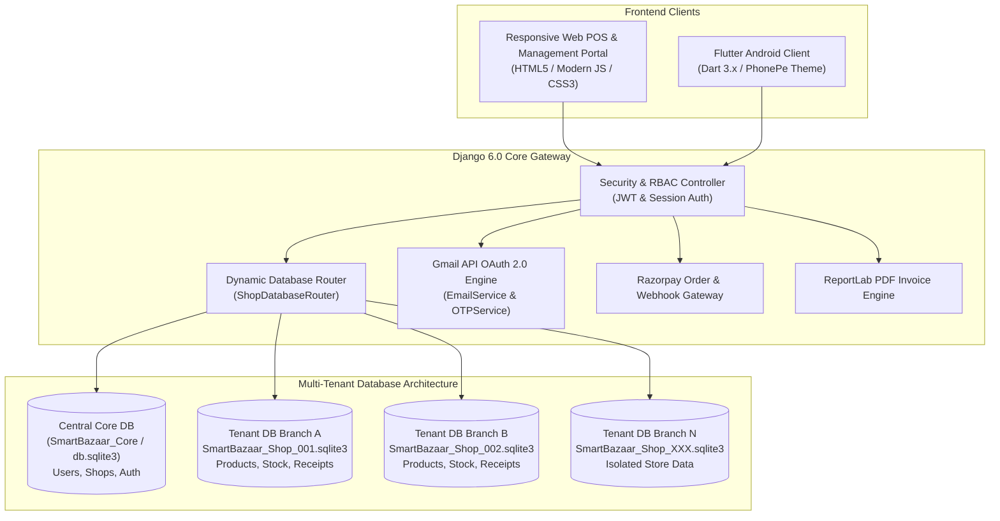

# 🛒 Smart Bazaar — Enterprise Multi-Tenant Supermarket POS & Management System

[](https://www.python.org/)
[](https://www.djangoproject.com/)
[](https://www.django-rest-framework.org/)
[](https://flutter.dev/)
[](https://razorpay.com/)
[](https://developers.google.com/gmail/api)
[](https://www.sqlite.org/)
[](LICENSE)

**Smart Bazaar** is a commercial-grade, multi-tenant supermarket retail POS (Point of Sale) and inventory management ecosystem. Designed for hypermarkets, supermarket chains, and independent grocery stores, Smart Bazaar delivers **physical database isolation per retail branch**, instant **hardware barcode scanning**, **dual-mode checkout** (Cash & dynamic Razorpay UPI QR codes), **strict passwordless Gmail API OTP verification**, and **automated digital watermarked PDF invoice dispatch** sent directly to customer inboxes.

---

## 📑 Table of Contents

- [Key System Capabilities](#-key-system-capabilities)
- [System Architecture](#-system-architecture)
- [Multi-Tenant Database Isolation](#-multi-tenant-database-isolation)
- [Core Functional Workflows](#-core-functional-workflows)
  - [1. Real-Time Cashier POS Terminal](#1-real-time-cashier-pos-terminal)
  - [2. Dual-Mode Checkout & Dynamic UPI QR](#2-dual-mode-checkout--dynamic-upi-qr)
  - [3. Passwordless Gmail API OTP Engine](#3-passwordless-gmail-api-otp-engine)
  - [4. Automated PDF Receipt Engine](#4-automated-pdf-receipt-engine)
  - [5. Store Owner Inventory & Employee Portal](#5-store-owner-inventory--employee-portal)
- [Default Demonstration Accounts](#-default-demonstration-accounts)
- [Project Directory Structure](#-project-directory-structure)
- [Getting Started & Installation](#-getting-started--installation)
  - [Prerequisites](#prerequisites)
  - [Step 1: Clone Repository & Virtual Environment](#step-1-clone-repository--virtual-environment)
  - [Step 2: Install Backend Dependencies](#step-2-install-backend-dependencies)
  - [Step 3: Environment Configuration (.env)](#step-3-environment-configuration-env)
  - [Step 4: Database Setup & Migrations](#step-4-database-setup--migrations)
  - [Step 5: Run Django Development Server](#step-5-run-django-development-server)
  - [Step 6: Run Flutter Mobile App (Optional)](#step-6-run-flutter-mobile-app-optional)
- [REST API Endpoints Reference](#-rest-api-endpoints-reference)
- [Security & Compliance Highlights](#-security--compliance-highlights)
- [Contributing & License](#-contributing--license)

---

## 🌟 Key System Capabilities

- **🏬 Multi-Tenant Per-Store Database Isolation**: Each branch runs on its own dedicated SQLite database (e.g. `SmartBazaar_Shop_001.sqlite3`, `SmartBazaar_Shop_002.sqlite3`) automatically discovered by Django at boot. Central models remain synced in core storage without cross-database constraint collisions.
- **⚡ High-Speed Cashier POS Terminal**: Live barcode scanning, keyword instant filtering, real-time GST tax calculation, unit conversion (`PCS`, `KG`, `LTR`, `PACK`), and cart total adjustments.
- **💳 Dynamic Razorpay UPI QR Integration**: Staff can generate dynamic Razorpay payment orders. Customers scan the on-screen UPI QR code with pre-filled exact billing totals. System polls transaction status in real-time and auto-approves billing.
- **📧 Official Google Gmail API OAuth 2.0**: Zero simulated OTPs. High-deliverability RFC 822 MIME transactional emails with 6-digit cryptographic verification codes dispatched for owner registration, staff onboarding, and customer billing attachments.
- **🧾 Watermarked Digital PDF Receipts**: Automated invoice generation featuring custom supermarket logos, store watermarks, itemized table summaries, tax breakups, cashier IDs, and customer loyalty balances.
- **👥 4-Tier Role-Based Access Control (RBAC)**: Enforced permission boundaries between `SUPER_ADMIN` (Platform Governance), `SHOP_OWNER` (Catalog & Staff Management), `WORKER / CASHIER` (POS Terminal), and `CUSTOMER` (Digital Wallet & Receipts).
- **📱 PhonePe-Inspired Flutter Mobile Client**: Cross-platform Android application built with Flutter & Dart, offline drift sync, central elevated QR scanner, and Bluetooth thermal printer hooks.

---

## 🏛️ System Architecture



---

## 💾 Multi-Tenant Database Isolation

Unlike naive multi-tenant setups that filter records by a simple `shop_id` foreign key inside a single shared table, **Smart Bazaar enforces true physical database sharding**:
- Every store registered by the Super Admin receives its own dedicated database file (`SmartBazaar_Shop_XXX.sqlite3`).
- All product catalogs, inventory transactions, cash receipts, and store ledger balances reside strictly inside that tenant's database.
- Central models (`User`, `Shop`, `ShopMembership`, `CustomerProfile`, `AuditLog`) reside in `db.sqlite3` (`default`), with automatic background synchronization to ensure zero foreign-key constraint violations on SQLite.
- `settings.py` auto-discovers and mounts all tenant database files at startup into Django's connection pool.

---

## 🔄 Core Functional Workflows

### 1. Real-Time Cashier POS Terminal
1. Cashier logs into their store branch (e.g. `Hamza Madari` at `SB-SHOP-002`).
2. Terminal prompts for **Customer Identification (Step 1)**:
   - Cashier enters customer's 10-digit mobile number.
   - If registered: Customer profile, loyalty points, and history attach immediately.
   - If new: Cashier enters customer name and Gmail address. The system triggers a 6-digit OTP verification code via Gmail API. Upon manual entry, the profile is permanently activated.
   - Cashier can also select **Walk-in Guest** for immediate anonymous checkout.
3. Barcode scanner unlocks: items are scanned via hardware barcode reader or instant search. Quantity, discounts, and tax rates update dynamically.

### 2. Dual-Mode Checkout & Dynamic UPI QR
1. When checking out, cashier asks: *"How would you like to pay?"*
2. **Option A — Cash**:
   - Cashier enters tender amount received; change is calculated automatically.
   - Clicking **Complete Cash Checkout** finalizes the ledger transaction.
3. **Option B — Online UPI / Razorpay**:
   - Clicking **Pay Online** generates a dynamic Razorpay payment link.
   - A scannable UPI QR code appears on the cashier screen with the **exact billing amount**.
   - Cashier/Customer can scan using any UPI app (Google Pay, PhonePe, Paytm, BHIM, Cred).
   - System polls `/api/pos/check-payment-status/` in real-time. Upon payment confirmation, the modal auto-advances to the success state.

### 3. Passwordless Gmail API OTP Engine
- Uses official Google Gmail REST API via OAuth 2.0 (`https://www.googleapis.com/auth/gmail.send`).
- Generates time-sensitive (5-minute expiration) 6-digit cryptographic OTPs.
- Automatic rate-limiting and cooldown enforcement (60-second re-send delay, 5 maximum incorrect attempt lockouts).
- OTP inputs start completely blank (`value=""`), requiring manual code entry by the user.

### 4. Automated PDF Receipt Engine
- Built with Python `ReportLab` and custom canvas renderers.
- Features:
  - Transparent store background watermark.
  - Supermarket header, GSTIN, branch address, cashier identity.
  - Itemized product table (Qty, Unit, MRP, Rate, Net Amount).
  - Tax breakdown (CGST + SGST), discount savings summary, and reward points balance.
  - Interactive QR code verification link printed at the bottom of the bill.
  - Automatically attached as a PDF and dispatched to the customer's registered Gmail address upon payment completion.

### 5. Store Owner Inventory & Employee Portal
- Store Owners have full autonomy over their branch catalog:
  - Add products with custom pricing, MRP, barcodes, and opening stock.
  - Live inventory tracking with automated low-stock warnings (reorder threshold alerts).
  - Staff management: Add workers and cashiers with unique employee codes (`SB-EMP-XXX`) and POS credentials.
  - Super Admin is strictly prevented by RBAC from modifying individual shop catalogs, maintaining administrative hierarchy.

---

## 🔑 Default Demonstration Accounts

| Role | Username / Identifier | Default Password | Assigned Scope & Purpose |
|---|---|---|---|
| **Super Admin** | `admin` | `Admin@123` | Platform oversight, store approvals, system-wide audit trail |
| **Shop Owner (Branch A)** | `owner_grocery` | `OwnerPass@123` | Admin for Smart Bazaar Branch A (`SB-SHOP-001`) |
| **Shop Owner (Branch B)** | `owner_anita` | `OwnerPass@123` | Admin for Smart Bazaar Branch B (`SB-SHOP-002`) |
| **Cashier / Worker** | `cashier_h_1111` | `WorkerPass@123` | Cashier Manager at Branch B (`SB-SHOP-002`) |
| **Cashier / Worker** | `cashier_b` | `WorkerPass@123` | Cashier Staff at Branch B (`SB-SHOP-002`) |
| **Registered Customer** | `9861283367` | *Gmail API OTP* | Customer with active loyalty points & email billing |

---

## 📂 Project Directory Structure

```text
Smart_Bazar/
├── backend/                         # Django Backend Core
│   ├── manage.py                    # Django management utility
│   ├── requirements.txt             # Python production dependencies
│   ├── smart_bazaar/                # Root configuration & settings
│   │   ├── settings.py              # Multi-tenant DB discovery & auth settings
│   │   ├── urls.py                  # API routing & landing views
│   │   ├── wsgi.py / asgi.py        # WSGI/ASGI gateways
│   │   └── token.json               # Google OAuth token cache
│   ├── apps/                        # Modular Django applications
│   │   ├── core/                    # Tenant router, provisioner, PDF & POS views
│   │   │   ├── db_router.py         # Multi-database query router
│   │   │   ├── database_provisioner.py # Tenant DB provisioner & sync
│   │   │   ├── receipt_pdf.py       # Watermarked invoice PDF generator
│   │   │   ├── views.py             # Main web POS terminal & dashboards
│   │   │   └── workflow_views.py    # Employee & Customer OTP registration
│   │   ├── accounts/                # User authentication & OTPService
│   │   ├── billing/                 # POS cart, sales & payment processing
│   │   ├── products/                # Product catalog & barcodes
│   │   ├── inventory/               # Stock movements & transaction ledger
│   │   ├── shops/                   # Shop entities & membership mappings
│   │   └── customers/               # Customer profiles & loyalty accounts
│   ├── databases/                   # Dedicated tenant SQLite databases
│   │   ├── SmartBazaar_Shop_001.sqlite3
│   │   ├── SmartBazaar_Shop_002.sqlite3
│   │   └── ...                      # Auto-discovered store databases
│   └── media/                       # Shop logos and receipts
├── mobile/                          # Flutter Android Application
│   ├── lib/                         # Dart source code
│   │   ├── main.dart                # Mobile entry point
│   │   ├── core/                    # Theme, colors & API services
│   │   └── screens/                 # POS, Scanner, Customer & Owner tabs
│   └── pubspec.yaml                 # Flutter package definitions
├── .env.example                     # Environment template (safe for Git)
├── .gitignore                       # Multi-tier exclusion rules
└── README.md                        # Master documentation
```

---

## 🚀 Getting Started & Installation

### Prerequisites
- **Python**: `3.12` or higher
- **Git**: Installed and configured on your machine
- **Flutter SDK**: `3.4+` (Only needed if running the mobile application)
- **Web Browser**: Chrome, Edge, Firefox, or Safari

---

### Step 1: Clone Repository & Virtual Environment

```bash
# Clone the repository
git clone https://github.com/Sushobhan004/Smart_Bazar.git
cd Smart_Bazar

# Create Python virtual environment
python -m venv venv

# Activate virtual environment
# Windows PowerShell:
.\venv\Scripts\Activate.ps1
# Windows CMD:
.\venv\Scripts\activate.bat
# Linux / macOS:
source venv/bin/activate
```

---

### Step 2: Install Backend Dependencies

```bash
cd backend
pip install --upgrade pip
pip install -r requirements.txt
```

---

### Step 3: Environment Configuration (`.env`)

Copy the example environment template in the project root:
```bash
cp ../.env.example .env
```
Open `.env` and fill in your credentials:
```env
PYTHONPATH=.;backend;backend/apps;apps
DJANGO_SETTINGS_MODULE=smart_bazaar.settings

# Google Gmail API OAuth 2.0 Credentials (for real OTP & PDF dispatch)
GMAIL_CLIENT_ID=your_client_id_here.apps.googleusercontent.com
GMAIL_CLIENT_SECRET=your_client_secret_here
GMAIL_REDIRECT_URI=https://developers.google.com/oauthplayground
GMAIL_REFRESH_TOKEN=your_refresh_token_here
GMAIL_SENDER_EMAIL=your_email@gmail.com

# Razorpay Test Mode Credentials (for Dynamic UPI QR)
RAZORPAY_KEY_ID=rzp_test_your_key_id
RAZORPAY_KEY_SECRET=your_secret_key
```

---

### Step 4: Database Setup & Migrations

```bash
# Apply central database migrations
python manage.py migrate

# (Optional) Seed standard demonstration catalog & test stores
python seed_data.py
```

---

### Step 5: Run Django Development Server

```bash
python manage.py runserver 127.0.0.1:8000
```
Open your browser and navigate to:
👉 **`http://127.0.0.1:8000/`**

---

### Step 6: Run Flutter Mobile App (Optional)

```bash
cd ../mobile
flutter pub get
flutter run
```

---

## 📡 REST API Endpoints Reference

| Method | Endpoint | Description |
|---|---|---|
| `POST` | `/api/admin/workers/send-otp/` | Dispatches 6-digit OTP to worker's Gmail for staff registration |
| `POST` | `/api/admin/workers/create/` | Validates OTP and creates unique employee POS login credentials |
| `POST` | `/api/shop/customers/send-otp` | Sends customer verification OTP via official Gmail API |
| `POST` | `/api/shop/customers/create/` | Verifies OTP and attaches/creates customer profile in POS |
| `GET` | `/api/auth/customers/search/?phone={num}` | Looks up customer by 10-digit mobile number |
| `POST` | `/api/admin/products/add/` | Adds product to central catalog and mirrors to tenant DB |
| `POST` | `/api/admin/products/update/` | Updates selling price and stock inventory levels |
| `POST` | `/api/admin/products/delete/` | Deletes product across central and tenant storage |
| `POST` | `/api/pos/create-payment-order/` | Generates Razorpay payment order and dynamic UPI QR |
| `POST` | `/api/pos/check-payment-status/` | Real-time polling check for UPI transaction status |
| `POST` | `/api/pos/web-checkout/` | Completes cash/online bill, generates PDF & emails receipt |

---

## 🔒 Security & Compliance Highlights

1. **No Plaintext Passwords**: All user credentials hashed with `PBKDF2-SHA256` (1,200,000 iterations).
2. **Cryptographic OTP Tokens**: One-time passwords are never stored in plaintext; stored as `SHA-256` digests with strict expiration timestamps and single-use flags.
3. **Multi-Database Cross-Isolation Protection**: SQLite foreign key constraints are handled gracefully through application-level ORM transactions, preventing database locks across disjoint SQLite files.
4. **Git Hygiene & Secret Protection**: Strict `.gitignore` rules prevent `.env` credentials, private SQLite databases, and virtual environments from ever being committed to version control.

---

## 🤝 Contributing & License

Contributions, bug reports, and feature requests are welcome! Feel free to open an issue or submit a Pull Request.

Distributed under the **MIT License**. See `LICENSE` for more information.

---

<p align="center">
  <b>Smart Bazaar</b> — Crafted with ❤️ by <a href="https://github.com/Sushobhan004">Sushobhan Pratihari</a>
</p>
